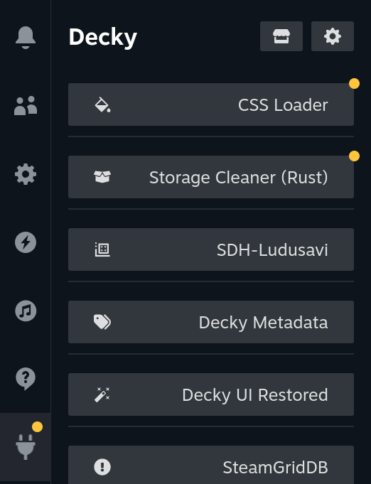
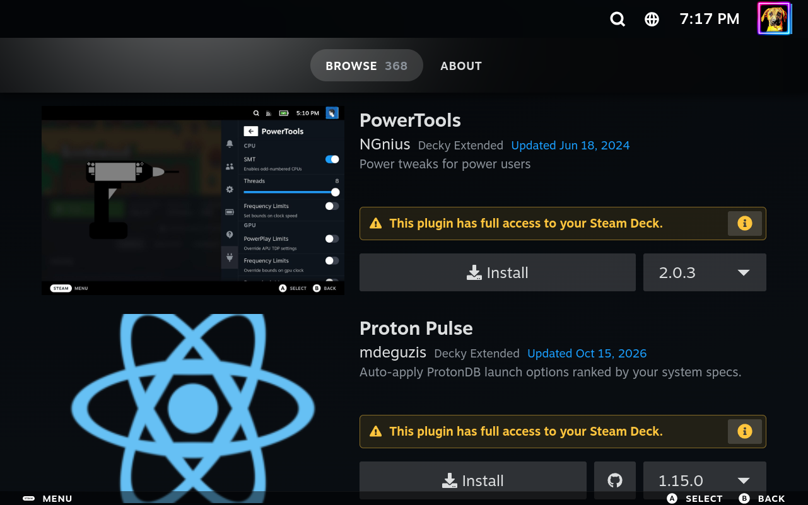
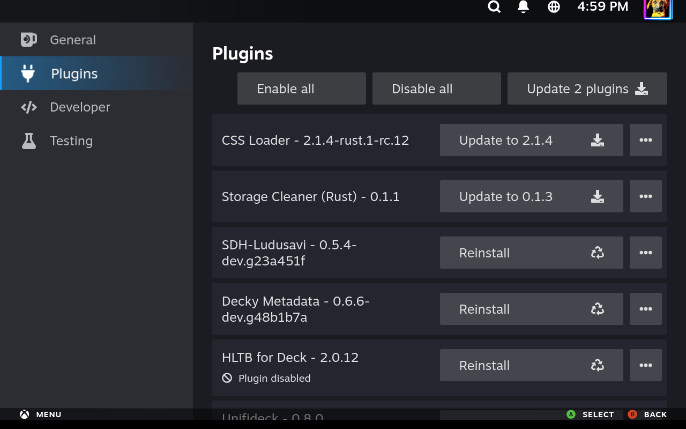

# Decky Loader (Rust fork)

Decky Loader adds plugins to Gaming Mode on the Steam Deck and Linux gaming PCs. Plugins can [restyle menus](https://github.com/suchmememanyskill/SDH-CssLoader), [change system sounds](https://github.com/EMERALD0874/SDH-AudioLoader), [adjust colors](https://github.com/libvibrant/vibrantDeck), and more.

> [!IMPORTANT]
> **Works with newer Steam Beta updates.** Newer Steam Client Beta updates changed how Gaming Mode is built, which stops the official Decky Loader from starting. This fork adapts automatically so Decky and most plugins keep working on both Steam Stable and Steam Beta, with no extra steps.
>
> With Steam Deck `publicbeta` `1795048523` (changelist `11255874`), released Nov. 18, 2026, Valve migrated `steamui` from Webpack to Vite + Rolldown + LightningCSS. This resulted in a rare change to nearly all CSS class names, and most React components and internal stores moving from stable Webpack module IDs to minified chunk bindings.  Certain plugins may not work on Beta if they have not updated to accommodate this migration.

This is an independent fork of [SteamDeckHomebrew/decky-loader](https://github.com/SteamDeckHomebrew/decky-loader). Gaming Mode looks and works the same and your existing plugins keep working, while the background service is rebuilt in Rust to run lighter, faster, and under your normal user account instead of `root`.

<table>
  <tr>
    <td align="center" width="24%"></td>
    <td align="center" width="38%"></td>
    <td align="center" width="38%"></td>
  </tr>
</table>

## Why use this fork?

| Area | Official Decky | This fork | Learn more |
|---|---|---|---|
| **Speed & memory** | Python loader (~38.6 MB idle RAM, 1.94 s start, 5.36 s stop) | Rust loader (**8.4 MB** idle RAM, **0.88 s** start, **0.18 s** stop, ~30% less idle CPU) | [Benchmarks](docs/guides/benchmarks.md) |
| **Account security** | Runs loader and all plugins as administrator (`root`) | Runs under your normal account; root plugins are **off by default** in an isolated helper with a 10 s wait + password per install | [Root Plugins](docs/guides/root-plugins.md) |
| **Plugin stores** | Single store at a time; no GitHub repo tracking | **Multiple stores** simultaneously ([Decky Extended](https://decky-extended-plugins.beallio.com/) included), priority ordering, GitHub repo URLs as stores, and custom-store update notices | [Plugin Stores](docs/guides/plugin-stores.md) |
| **Store browsing** | Basic catalog list; fails or stalls when a store is slow | **6 filters**, sort by update date, `Updated` dates, root badges, GitHub links, **6-hour cache**, and **20 s** per-store timeout | [Plugin Stores](docs/guides/plugin-stores.md) |
| **Install & recovery** | Single-version system service install | **Clickable GUI installer**, auto-backups before every change, **3-step undo**, and reversible migration from Official Decky | [Installation](docs/guides/installation.md) |
| **Everyday UI polish** | Modal warning timers on manual ZIP/URL installs; reload-page error lockouts | Clean in-place error recovery, no ZIP/URL warning countdown, dismissed toasts stay cleared, and preserved plugin order | — |
| **Plugin authors** | Python plugin backends only | Live CPU/RAM per plugin (`--status`), optional zero-Python **Rust backends**, and fast `decky.native.dumps` JSON | [Plugin Authors](docs/guides/plugin-authors.md) |

## Install in 3 steps

<a href="https://raw.githubusercontent.com/beallio/decky-loader/main/scripts/Install-Decky-Rust.desktop"></a>

*(Right-click **Download Installer** -> **Save Link As...** to save `Install-Decky-Rust.desktop`.)*

1. Switch to **Desktop Mode** (on Steam Deck: **Steam -> Power -> Switch to Desktop**).
2. Double-click **`Install-Decky-Rust.desktop`** (click **Continue / Trust and Launch** if prompted).
   - Official Decky already installed? The installer detects it automatically, moves you cleanly, and keeps your plugins and settings.
   - Works out of the box on **SteamOS, Bazzite (KDE & GNOME), CachyOS, Fedora, and Ubuntu**.
3. Pick **Install** (or **Move from Official Decky**), then return to **Gaming Mode** (restart your Deck if Decky does not appear right away).

> [!TIP]
> On **GNOME** desktops (Bazzite GNOME, Ubuntu, Fedora Workstation) or over **SSH**, you can also run the installer directly in Terminal:
> ```sh
> bash <(curl -fsSL https://raw.githubusercontent.com/beallio/decky-loader/main/scripts/install-gui.sh)
> ```
> Keep `Install-Decky-Rust.desktop` to update Decky, enable root plugins, undo updates, or restore Official Decky anytime. See the [Installation Guide](docs/guides/installation.md) for CLI and SSH options.

## Good to know

- **64-bit x86 Linux with `systemd` only:** Built for SteamOS and 64-bit Intel/AMD Linux PCs (no ARM, Windows, or macOS).
- **Root plugins are opt-in:** Plugins like PowerTools stay disabled until enabled, can only be installed from an active store or `https://` URL, and ask for your login password each install (passwordless `sudo` is blocked).
- **Normal-account limits:** Plugin file pickers show only folders readable by your normal account, and Decky cannot toggle SSH.
- **Fork updates & warnings:** Updates inside Gaming Mode stay on this fork (return anytime with **Restore Official Decky** / `--restore-legacy`), and custom stores do not show a warning prompt.

## Guides & Documentation

| Guide | What it covers |
|---|---|
| **[Installation & Migration](docs/guides/installation.md)** | Graphical installer walkthrough, moving from Official Decky, 3-step undo, CLI & SSH flags |
| **[Plugin Stores & GitHub](docs/guides/plugin-stores.md)** | Multiple stores, priority ordering, adding GitHub repos, filters, caching, timeouts |
| **[Root Plugins](docs/guides/root-plugins.md)** | Enabling isolated root plugin support, per-install consent, security rules, turning it off |
| **[Speed & Memory Benchmarks](docs/guides/benchmarks.md)** | Official Decky vs. Rust loader metrics, Python vs. Rust plugin benchmarks, `--status` |
| **[Troubleshooting](docs/guides/troubleshooting.md)** | Fixing missing QAM menu, Steam Beta plugin errors, ports 1337/8080, legacy upgrades, debug logs |
| **[For Plugin Authors](docs/guides/plugin-authors.md)** | `root` permissions, `decky.native.dumps`, Rust plugin backends, Steam Beta compatibility |
| **[Development](docs/development.md)** | Building from source, Rust runtime packaging, native plugin backend SDK, testing |
| **[Root Plugin Host Design](docs/root-plugin-host.md)** | Architecture, socket activation, control protocol, and threat model |
| **[Vite SteamUI Hooking](docs/vite-esm-hooking.md)** | Technical design and component discovery for Vite + Rolldown SteamUI builds |

## Credits

Decky Loader is made by [Steam Deck Homebrew](https://github.com/SteamDeckHomebrew) and its contributors. The original idea is from [marios8543's Steam Deck UI Inject project](https://github.com/marios8543/steamdeck-ui-inject).
