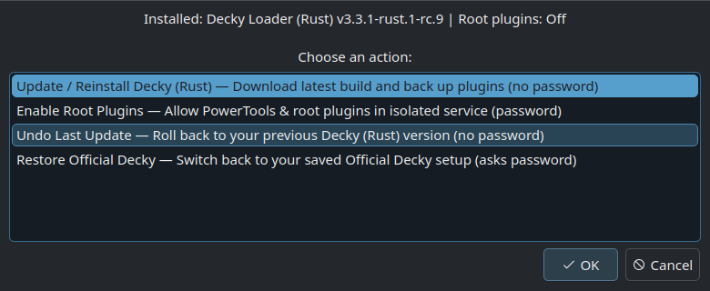

# Installation, Updates & Moving from Official Decky

Decky Loader (Rust fork) installs into your normal Linux user account using `systemd --user`, keeps automatic backups before every change, and includes a graphical installer that works out of the box across **SteamOS, Bazzite (KDE & GNOME), CachyOS, Fedora, and Ubuntu**.

You do not need a GitHub account, developer mode, or build tools.

> [!NOTE]
> This fork currently has preview releases (`--channel preview`) rather than stable releases yet. Both the graphical launcher and the Gaming Mode **Prerelease** update channel use those preview builds.

---

## Option 1: Graphical Installer (Recommended)



The graphical installer checks what is currently on your device, highlights the recommended next step, and only asks for your password when an action actually needs administrator access (moving from Official Decky, enabling/disabling root plugins, or restoring Official Decky).

1. Switch to **Desktop Mode** (on Steam Deck: **Steam button -> Power -> Switch to Desktop**).
2. Download **[Install-Decky-Rust.desktop](https://raw.githubusercontent.com/beallio/decky-loader/main/scripts/Install-Decky-Rust.desktop)** to your **Downloads** folder (Right-click -> **Save Link As...**).
3. Run it for your desktop environment:
   - **KDE Plasma (SteamOS, Bazzite KDE, CachyOS KDE, Kubuntu):** Open **Downloads** in Dolphin and double-click `Install-Decky-Rust.desktop` (click **Continue** or **Trust and Launch** if prompted).
   - **GNOME (Bazzite GNOME, Fedora Workstation, Ubuntu):** Move `Install-Decky-Rust.desktop` onto your Desktop, right-click it and choose **Allow Launching**, then double-click it — **or** open Terminal and paste:
     ```sh
     bash <(curl -fsSL https://raw.githubusercontent.com/beallio/decky-loader/main/scripts/install-gui.sh)
     ```
4. Pick your action in the window and wait for the **All done!** message.
5. Return to **Gaming Mode** (restart your Steam Deck if Decky does not appear in the Quick Access Menu right away).

> [!TIP]
> You can keep `Install-Decky-Rust.desktop` and run it again anytime to update Decky, toggle [root plugins](./root-plugins.md), undo an update, or switch back to Official Decky. If neither `kdialog` nor `zenity` is installed, the script automatically falls back to a clean numbered terminal menu.

---

## Moving from Official Decky

Official Decky runs as administrator (`root`). You do not need to uninstall it first — this fork backs it up and moves your existing plugins and settings to your normal account.

- **With the graphical installer:** Launch `Install-Decky-Rust.desktop`. It detects Official Decky automatically and pre-selects **Move from Official Decky**.
- **From Konsole / Terminal:**
  ```sh
  curl -fsSL https://raw.githubusercontent.com/beallio/decky-loader/main/scripts/install-to-deck.sh -o ~/Downloads/install-to-deck.sh
  bash ~/Downloads/install-to-deck.sh --migrate-legacy --channel preview
  ```

You will be asked for your login password once so the installer can stop and park the Official Decky system service. If you have never set a desktop password on a fresh Steam Deck, open Konsole and run `passwd` first to create one.

---

## Updating Decky

In Gaming Mode, open Decky settings -> **General** -> **Updates** -> **Check For Updates**.

- Choose **Prerelease** under **Update Channel** for preview releases (currently recommended while this fork is in preview), or **Stable** once stable releases are published.
- You can also update anytime by running `Install-Decky-Rust.desktop` or re-running the terminal installer.

---

## Undoing an Update & Restoring Official Decky

Every change saves a backup of your `homebrew` folder (your plugins and settings) in `~/decky-user-backups`, keeping the **3 newest copies** and deleting older ones to save disk space. You can change the backup location with `--backup-dir FOLDER`.

### Roll back to a previous version of this fork

You can roll back up to **3 versions** without a password:

- **Graphical installer:** Choose **Undo Last Update**.
- **Terminal:**
  ```sh
  bash ~/Downloads/install-to-deck.sh --undo
  ```

Undo switches Decky back to the earlier version without erasing your plugin data. If you ever need an older copy of your plugin files, look inside `~/decky-user-backups`.

### Switch back to Official Decky

If you moved from Official Decky, a saved copy of its system service is kept until you delete it:

- **Graphical installer:** Choose **Restore Official Decky**.
- **Terminal (asks password once):**
  ```sh
  bash ~/Downloads/install-to-deck.sh --restore-legacy
  ```

Once this fork has been working smoothly for a few days and you want to reclaim the space used by the saved Official Decky backup, you can remove that copy:

```sh
bash ~/Downloads/install-to-deck.sh --forget-legacy
```

After running `--forget-legacy`, **Restore Official Decky** (`--restore-legacy`) is no longer available.

---

## Option 2: Command-Line & Remote SSH Install

Download [install-to-deck.sh](../../scripts/install-to-deck.sh) (or see all flags with `bash install-to-deck.sh --help`):

```sh
cd ~/Downloads
curl -fsSL https://raw.githubusercontent.com/beallio/decky-loader/main/scripts/install-to-deck.sh -o install-to-deck.sh

# Dry-run check: tests download and target without changing anything
bash install-to-deck.sh --check --channel preview

# Install or update the latest preview build
bash install-to-deck.sh --channel preview

# Install one exact release tag
bash install-to-deck.sh --version v3.3.1-rust.1-rc.9

# Check service health and live CPU / memory per plugin
bash install-to-deck.sh --status
```

### Install over SSH from another Linux PC

Add `--remote` followed by your Steam Deck's hostname or SSH alias:

```sh
bash install-to-deck.sh --remote steamdeck --channel preview
```

---

## Differences & Limitations Compared to Official Decky

Keep these differences in mind before switching:

- **64-bit Intel/AMD Linux with `systemd` only:** Works on SteamOS, Steam Deck, and 64-bit x86 Linux gaming PCs (Bazzite, CachyOS, Fedora, Ubuntu, etc.). It does not support ARM devices, Windows, or macOS.
- **Root plugins are off by default:** Plugins like PowerTools do not run until you opt in. See the [Root Plugins Guide](./root-plugins.md).
- **Normal-account file browser:** When a plugin opens a file picker, you can only browse folders readable by your normal user account (`deck`).
- **No SSH toggle in Decky settings:** Starting or stopping SSH requires administrator privileges and is not exposed inside Decky.
- **Updates come only from this fork:** Using **Check For Updates** inside Gaming Mode installs newer releases of this fork, not Official Decky.
- **No warning prompt when adding a custom store:** Official Decky warns before enabling third-party stores; this fork expects you to add only plugin stores and GitHub repositories you trust.
