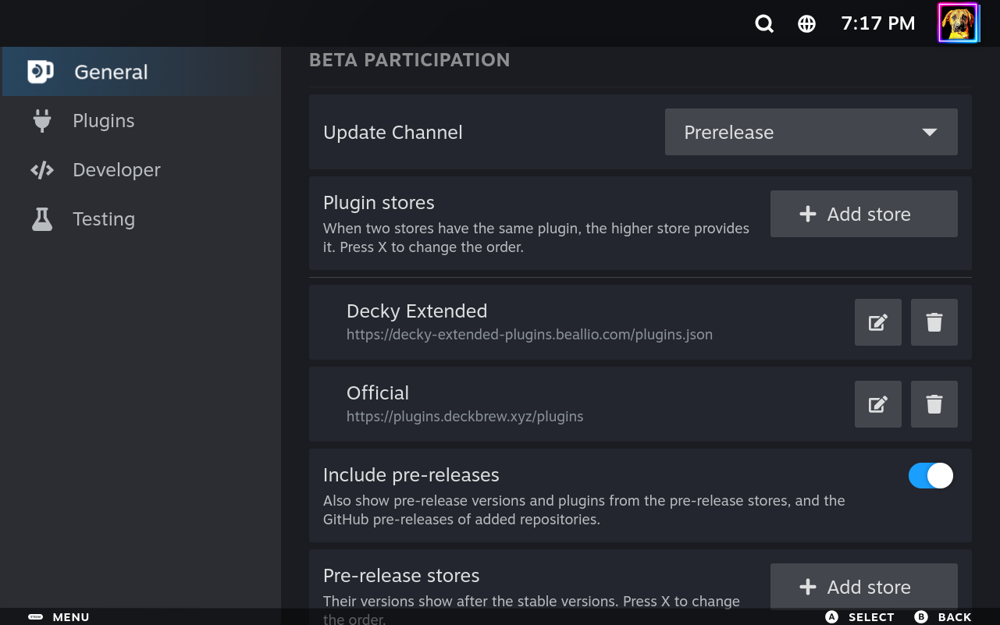
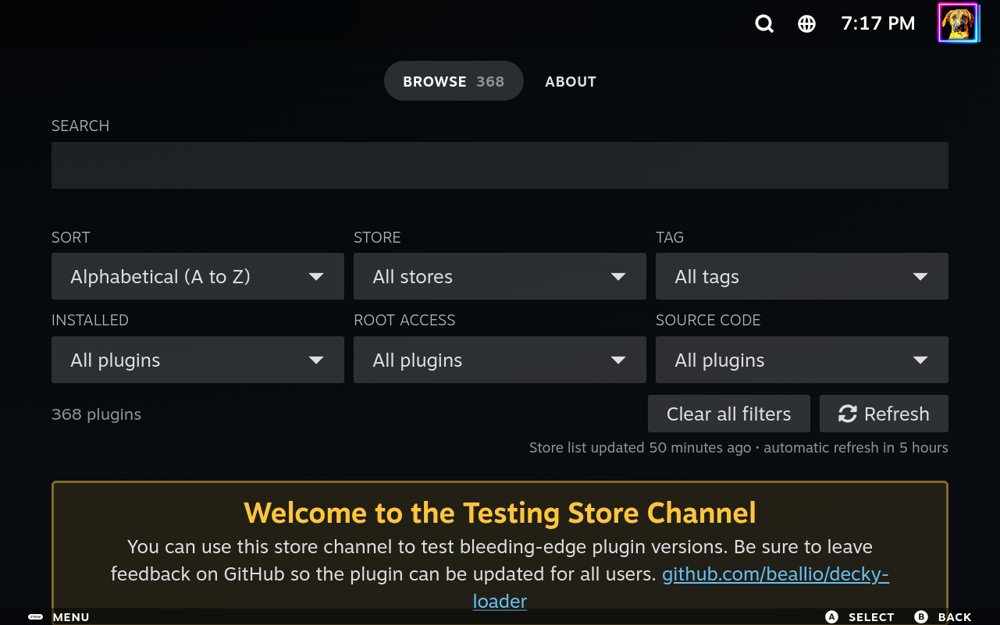
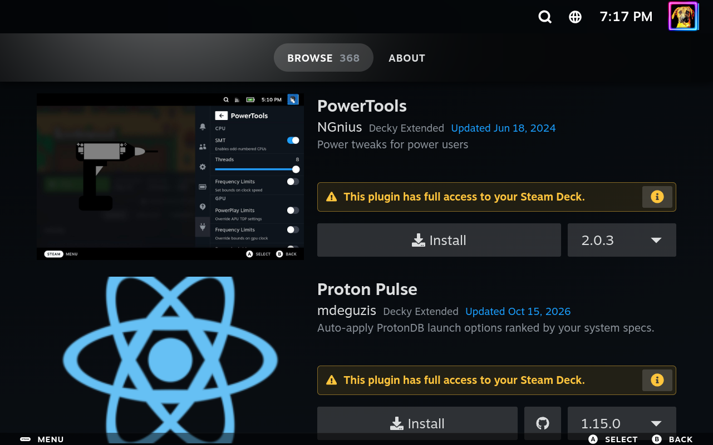

# Plugin Stores & GitHub Repositories

Decky Loader (Rust fork) can browse, install, and check updates across **multiple plugin stores at the same time** — including individual GitHub plugin repositories — with built-in filtering, sorting, caching, and timeout protection.

---

## Managing Stores in Settings

Open Decky settings -> **General** and scroll to **Plugin stores**:

- **Default stores:** **[Decky Extended](https://decky-extended-plugins.beallio.com/)** and the **Official** Decky store are both enabled out of the box.
- **Change store priority:** Press **X** on the store list, move a store up or down, and press **X** again to save.
  - When two stores carry the same plugin, the store **higher in the list** is the primary store for that plugin and sends update notices for it.
  - Other versions from lower-priority stores remain available in that plugin's version dropdown.
- **Add a custom store:** Select **Add store** and enter the store's `plugins.json` web address. Decky checks custom stores for plugin updates automatically too (including custom stores that Official Decky cannot check).
- **Pre-release stores & builds:** Turn on **Include pre-releases** to include the testing stores (Official testing and Decky Extended testing) plus pre-release builds from any GitHub repositories you added. Pre-release versions are marked **Pre-release** and can appear as updates.

> [!NOTE]
> Unlike Official Decky, this fork does not show a warning pop-up when you add a custom store. Only add stores and GitHub repositories that you trust.

---

## Adding a Plugin Directly from GitHub

You can paste a single plugin's GitHub repository URL — for example `https://github.com/owner/repo` — into **Add store**:

- Decky automatically reads the plugin's name, author, tags, description, icon/image, and GitHub releases as selectable versions.
- When new releases are published on GitHub, Decky offers them alongside normal store updates.

A few practical limits apply to GitHub repository stores:

- **One `.zip` per release:** Releases that attach more than one `.zip` archive are skipped because Decky cannot safely guess which archive is the plugin package.
- **Checksums required (mid-2025 or newer):** Decky only installs GitHub release assets when GitHub provides a SHA-256 checksum for the file (GitHub began publishing asset digests in mid-2025, so older releases without a digest will not appear).
- **Rate limit (~60 checks per hour):** Unauthenticated GitHub API requests share an hourly limit of roughly 60 checks per network address, so use GitHub repo stores for a handful of plugins rather than dozens.

---

## Browsing, Filtering & Sorting the Store

The Store's **Browse** tab gives you quick controls across all active stores:

- **Sort** alphabetically or by **most recently updated**.
- **Filter** by **Store**, **Tag**, **Installed** status, **Root access** requirement, or **Source code** availability, plus live **Search** and **Clear all filters**.
- **Per-card details:** Every plugin card displays which store provides it, when it was last **Updated**, a warning banner if the plugin requires **administrator (root) access**, a direct **GitHub** button when source links exist, and a version selector.

---

## Slow or Offline Stores Won't Break Browsing

Each store request has a **20-second timeout**, and Decky saves every store's catalog locally for **6 hours** (as seen in the timestamp above the list, with a manual **Refresh** button whenever you want to pull immediately):

- If one store times out or goes offline, Decky shows a notice along with plugins from the other stores instead of failing the whole page.
- While a higher-priority store fails to answer, Decky pauses automatic update notices from stores ranked **below** it until that store responds again, preventing unexpected cross-store switches.
