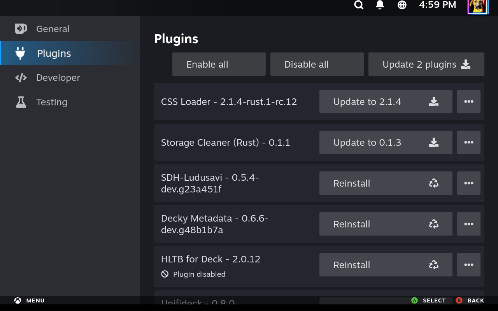
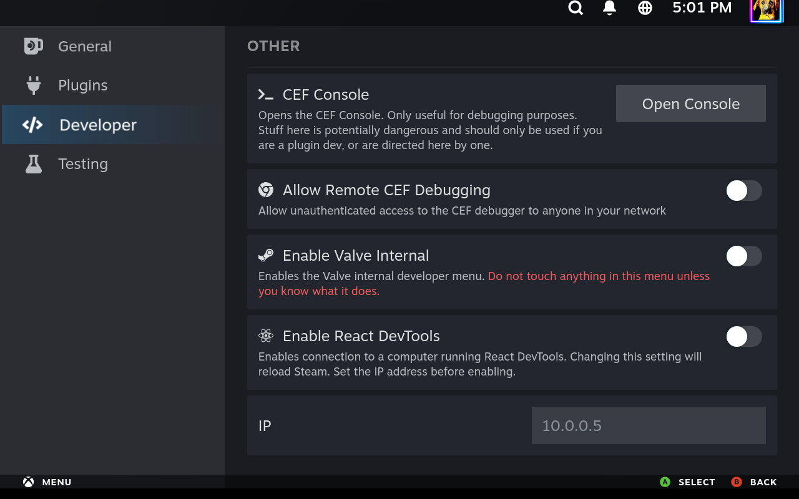
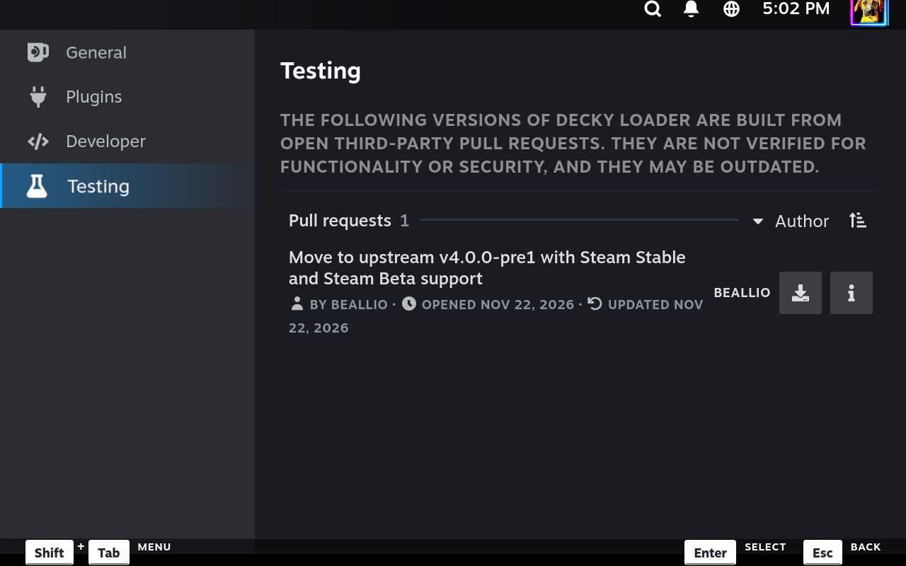
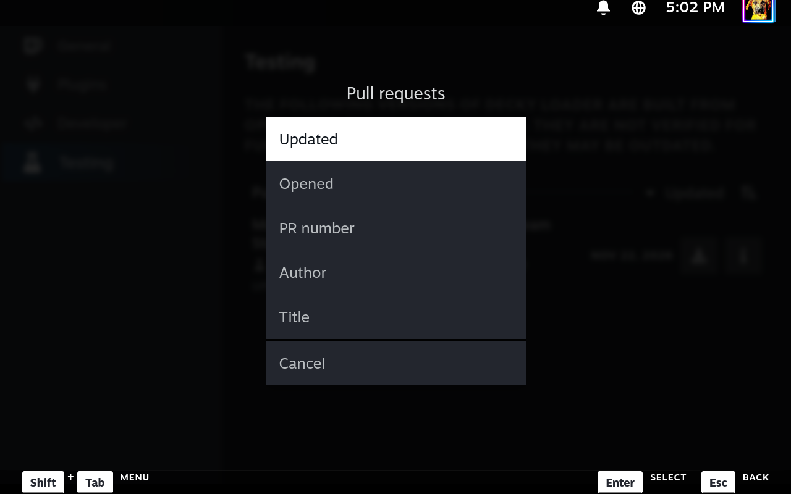

# Decky Settings

Open Decky settings from the Quick Access Menu to manage plugins, stores, updates, and developer options. The **Developer** and **Testing** pages show only when **Developer mode** is on: open **General** -> **Other** and turn on **Developer mode**.

## General

The **General** page has update settings and plugin stores. Scroll to **Plugin stores** to manage stable and pre-release stores. See the [Plugin Stores Guide](./plugin-stores.md).

## Plugins

Use **Enable all** or **Disable all** to change every plugin's state. Decky processes plugins one at a time. If one change fails, Decky shows an error and continues with the others. **Enable all** also enables plugins that you had turned off before.

## Developer

The **IP** setting for React DevTools accepts an IPv4 address. Enter four numbers from 0 to 255, separated by dots.

## Testing

The **Testing** page lists pull request builds. They are not verified for functionality or security, and they may be outdated. You can sort the list by updated date, opened date, pull request number, author, or title.

Select the sort label (for example **Updated**) to choose a sort field. Select the arrow icon next to it to switch between ascending and descending order. The value on the right side of each row shows the field you sort by.

To install a build and return to a regular update channel, see [Trying a Pull Request Build](./installation.md#trying-a-pull-request-build).
