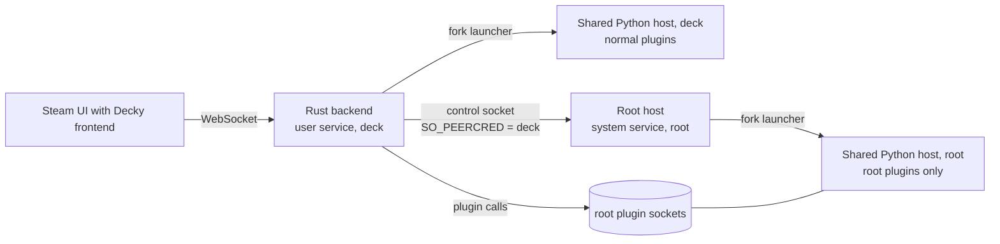

# Root plugin host (design)

Status: phases 1 to 4 built and tested on the SteamOS VM (2026-10-17): the host, opt-in and
opt-out, folder checks, start and stop, status, backend integration, store install, update and
uninstall through the host, and runtime updates that follow Decky updates. Phase 5 (security
review) remains.

## Goal

Let plugins that are marked `root` in `plugin.json` run, while the Rust loader and all other
plugins continue to run as the normal user (`deck`).

4 of the 30 most-downloaded store plugins need root: PowerTools, AutoFlatpaks, DeckMTP and
Fantastic. Today the fork refuses them.

## Non-goals

- Running the whole loader as root. The `--system` mode was considered and rejected.
- Running root plugins without the user's opt-in. Users who never enable root plugins get no root
  service and no new root files.
- Making root plugins safer than they are on official Decky. A root plugin is root code. This
  design keeps the rest of the system from becoming root code, and keeps a compromised `deck`
  account from turning arbitrary code into root code.

## How official Decky does it

The official loader runs as root. Its plugin host keeps root for plugins with the `root` flag and
switches every other plugin to the `deck` user before it imports the plugin. Root plugins get
`HOME=/root`, `USER=root`, and the same `DECKY_PLUGIN_*` folders under `~/homebrew` as other
plugins.

## Threat model

| Attacker | Must not be able to |
|---|---|
| Any process running as `deck` (malware, a compromised non-root plugin, a browser exploit in Steam) | Run its own code as root through the root host |
| A different local user | Talk to the root host at all |
| A store plugin marked `root` | Nothing extra: it is root by design, the same as on official Decky |

Consequences:

1. Root must never execute a file that `deck` can change: the runtime binary, the Python worker,
   or plugin code. The `deck` install under `~/homebrew/services` is writable by `deck`, so the root
   host needs its own root-owned copy.
2. Root plugin code stays in `~/homebrew/plugins/<dir>`, as on official Decky, but owned by root
   with no group or other write. `deck` cannot change these files, but it owns the parent folder,
   so it can rename or replace the whole plugin folder. Two safeguards close this:
   - At install, the host records a SHA-256 of the plugin's file tree in its root-owned state. At
     every start it checks through an open folder descriptor that the folder and every file in it
     are root-owned and not group or other writable, and that the tree hash matches. A folder that
     `deck` made cannot pass, because `deck` cannot create root-owned files. A swapped root-owned
     folder fails the hash check.
   - Each root plugin runs in its own mount namespace. The checked folder is mounted read-only
     at a root-owned path, `/home/.decky-loader-runtime/root-host/<uid>/mnt/<dir>`, with
     slave propagation so new USB and SD card mounts still appear. `DECKY_PLUGIN_DIR` and the
     plugin's `__file__` point there. Linux binds only from mounts in the caller's namespace, so
     after `unshare` the child opens the public path again and mounts it only if its device and
     inode match the checked descriptor. A swap after the check does not reach the plugin,
     including programs that the plugin starts from its `bin/` folder. Python imports go through
     the checked descriptor as for other plugins.
3. The root host must not accept plugin code from `deck`. It downloads root plugins itself and
   checks the store's SHA-256. It accepts a download from the official store hosts on its allow
   list, or a download that the store set in Decky lists, with the same SHA-256, for that plugin:
   the host reads that store's plugin list itself.

Accepted risks (the user's decisions; the first two are the same as on official Decky):

- A root plugin's settings, data and log folders stay at `~/homebrew/{settings,data,logs}/<dir>`
  and are owned by `deck`, as on official Decky. A root plugin writes there as root. A `deck`
  process can put a symlink in these folders and make the plugin overwrite a file that `deck` may
  not change. The host does not follow symlinks when it creates these folders, but it cannot
  protect files that the plugin opens later by name.
- Approval of each root plugin install or update is a confirmation box in the Decky interface,
  with no password. The box waits 10 seconds and needs an "I understand" switch. A `deck` process
  can answer it itself, so the box protects against mistakes, not against such a process.
- The store set in Decky is trusted for root plugins (user decision, 2026-10-17). Decky's settings
  belong to `deck`, so a `deck` process can switch to its own store and have its code installed as
  root. The listing check only stops downloads that the store set in Decky does not publish.

## Parts

| Part | Where | Owner |
|---|---|---|
| Root host binary and Python worker | `/home/.decky-loader-runtime/root-host/<uid>/runtimes/<id>/` (copied from a verified bundle). Not `/var/lib`: on SteamOS `/var` is a 230 MB partition and each runtime is about 100 MB | root, mode 0755 |
| Root plugin code | `~/homebrew/plugins/<dir>/`, as on official Decky; tree hash in `state.json` | root, no group or other write |
| Root host config and state (approved plugins, tree hashes, runtime, store hosts) | `/home/.decky-loader-runtime/root-host/<uid>/{config,state}.json` | root, 0644 |
| Control socket | `/run/decky-loader-runtime/<uid>/root-host.sock`, from a systemd socket unit | file owned by `deck`, mode 0600; the folder is root-owned, mode 0711 |
| Root plugin IPC sockets | `/run/decky-loader-runtime/<uid>/root-plugins/` | root folder 0711; each socket is given to `deck` with mode 0600 |
| Units | `/etc/systemd/system/decky-root-plugins-<user>.{socket,service}` | root |

SteamOS keeps `/etc` and `/var` across OS updates. The legacy migration already uses both.

The root host is a new subcommand of the same Rust binary (`decky-loader-runtime root-host --user
deck`). It reuses the existing fork-launcher supervision, the approved-folder launch and process
cleanup. It starts the shared Python host as root, with the `lean` bootstrap, and serves only root
plugins.

## Control protocol

One JSON object per line on the control socket. The host accepts a connection only if
`SO_PEERCRED` shows the configured user's UID. It accepts only one connection at a time. Requests:

| Request | Effect |
|---|---|
| `hello {protocol, auth_token, server_host, server_port, loader_version}` | First request. When `loader_version` is a release tag that differs from the root runtime, the host starts a runtime update (below) |
| `list` | Approved root plugins: folder, name, version, running |
| `start {id, directory}` | Check the plugin folder (below), start it, and return its PID and IPC socket path |
| `release`, `status`, `stop`, `forget {id}` | The same plugin lifecycle as the user service's launcher; `stop` sends SIGTERM, then SIGKILL after 5 s |
| `install {directory, name, sha256, artifact, store_url}` | Download `artifact` (https; an allowed store host, or a download that the plugin list at `store_url` gives for `name` with the same `sha256`), check its store SHA-256, unpack the store folder into a root-owned staging folder through descriptors, check `plugin.json` (name matches, `root` flag present), fetch `remote_binary` files (each checked by its SHA-256), record the tree hash, then swap it into place |
| `uninstall {directory}` | Delete a root-owned plugin folder and its approval. Settings and data stay, as on official Decky |

The host never takes file paths, file descriptors or code from the backend. It takes names, and
for downloads, URLs that are either on the allow list or listed by the store set in Decky. The
allow list is set once by root at opt-in time: the default store and its artifact host. The store
set in Decky is read from the backend with each install, so it follows the Decky settings.

Before each start, the host checks the plugin folder through an open folder descriptor: it and
every file in it are owned by root and not writable by group or others; there are no symlinks
that leave the folder; and the name, version and tree hash match `state.json`. It then starts the
plugin in a private mount namespace with the checked folder bind-mounted read-only at its normal
path. The plugin's settings, data and log folders are created owned by `deck`, as on official
Decky, without following symlinks.

## Lifecycle

- **Opt-in:** `bash install-to-deck.sh --enable-root-plugins`. It uses sudo once. It copies the
  verified runtime to the root location, writes the units and the allow list, and enables the
  socket unit. Approving an installed root plugin copies it into new root-owned files and swaps
  the folders, so a user process that held a plugin file open for writing cannot change the
  approved code. `--disable-root-plugins` stops everything, removes the units and runtime, and
  gives root plugin folders back to the user.
- **Start:** the socket unit starts the host when the backend connects. The backend connects only
  if at least one enabled plugin needs root. Without root plugins, no root process runs.
- **Backend restart or crash:** root plugins belong to the control connection that started them.
  When it closes, the host stops them at once (SIGTERM, then SIGKILL after 5 s). The backend starts
  them again when it reconnects. A root plugin never runs without a backend.
- **Host exit:** with no running root plugins and no connection for 60 s, the host exits.
- **Store install:** the backend sees the `root` flag in the downloaded `plugin.json` and sends
  `install` instead of unpacking the ZIP itself. Root plugins from a URL or a local ZIP are
  refused. Uninstall goes through the host for root-owned folders.
- **Loader update:** the backend sends its version in `hello`. If it is a release tag that is newer
  than the root runtime (the root runtime never moves back, so a process that reports an old
  version cannot make root install an old release), the host starts `install.py update-root-host`
  from its own root-owned runtime with a minimal environment. That downloads the release ZIP and
  its `.sha256` file from the fork's GitHub releases, checks them, unpacks and checks the bundle,
  and installs it as a new root runtime with new units. It changes only files. The running host
  keeps serving; when a new connection arrives and it has no connection and no plugins, it exits
  without accepting, and systemd starts the new runtime for that connection. The previous runtime
  is kept until the next update.
- **Status:** `install-to-deck.sh --status` shows the root host, its runtime and release, and the
  approved plugins.
- **Undo:** `--undo` changes only the user service. The root runtime stays on the newer release,
  which speaks the same protocol. `dev` builds never trigger an update.
- **Python module paths:** root plugins get only the system module folders of an isolated root
  `python3 -I`, and only folders that only root can change. The user service's paths come from
  `python3` run as the user and include the user's own module folder, which root must not import
  from.
- **Without opt-in:** root plugins show "This plugin needs root. Run `install-to-deck.sh
  --enable-root-plugins` to allow plugins that need root." in place of today's message.

## Cost

| | No root plugins enabled | One or more root plugins enabled |
|---|---|---|
| Memory | 0 | The root host process: measured 26.6 MB PSS (6.8 MB private) with one root plugin on the VM, the same as the user service's plugin host. It cannot share pages with the user service, because root runs its own root-owned copy of the runtime. The root plugins themselves cost the same as in any mode. |
| Idle CPU | 0 | 0; the host waits on sockets and has no timers |
| Per call | Unchanged | Unchanged: the backend calls the root plugin's socket directly |
| Disk | 0 | One more runtime copy, about 100 MB |

## Tests (SteamOS VM, owned units only)

1. PowerTools and Fantastic from the store: install, start, call methods, disable, enable,
   uninstall.
2. No opt-in: no root unit, no root process, and the new message.
3. Security:
   - A different UID cannot connect.
   - A `deck`-owned file put into a root plugin folder makes the start fail.
   - A swapped plugin folder makes the start fail.
   - An artifact URL off the allow list is refused.
   - A wrong SHA-256 is refused.
   - A swapped root-owned plugin folder (another root plugin's code) fails the hash check.
   - Inside the plugin, its folder is read-only, and a swap of the outside folder after the start
     does not change what the plugin sees.
4. Backend killed: root plugins stop, and start again when the backend returns.
5. In-app update with a host update, a failed host update, and `--undo`.
6. Idle: no root process when no root plugins are enabled; 0 CPU while root plugins are idle.
7. Memory: measure the real cost of the root host for the cost table.

## Build order

1. Root host subcommand, control protocol, folder checks, socket units, and
   `--enable-root-plugins` / `--disable-root-plugins` / `--status`. Done.
2. Backend integration: start, stop, reload, enable and disable through the host. Done.
3. Store install, uninstall and update through the host. Done.
4. Host runtime follows loader updates and `--undo`. Done.
5. Security review, then a stable release.

## Decisions (2026-10-17)

1. **Consent:** a confirmation box in the Decky interface before every root install or update
   (10-second wait and an "I understand" switch). No password per install. Enabling root plugins
   at all needs sudo once.
2. **Code place:** `~/homebrew/plugins/<dir>`, owned by root, as on official Decky, with the tree
   hash check and the read-only bind mount above. Checked on 2026-10-17: the 4 popular root
   plugins (PowerTools 2.0.3, AutoFlatpaks 1.6.8, DeckMTP 1.0.5, Fantastic 0.5.1) use
   `DECKY_PLUGIN_DIR` or paths relative to their own files. PowerTools, Fantastic and DeckMTP run
   programs from their own `bin/` folder; AutoFlatpaks runs `flatpak` and `chown`.
3. **Settings, data and logs:** `~/homebrew/{settings,data,logs}/<dir>`, owned by `deck`, as on
   official Decky. The symlink risk above is accepted.
