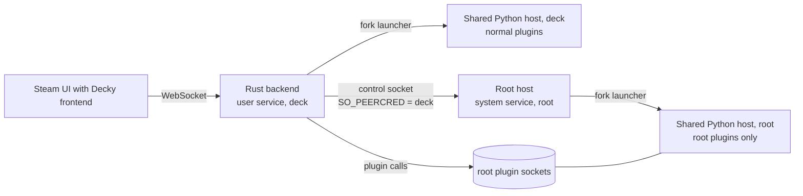

# Root plugin host (design)

Status: design approved on 2026-10-17 (see Decisions). Build in progress.

## Goal

Let plugins that are marked `root` in `plugin.json` run, while the Rust loader and all other
plugins continue to run as the normal user (`deck`).

4 of the 30 most-downloaded store plugins need root: PowerTools, AutoFlatpaks, DeckMTP and
Fantastic. Today the fork refuses them.

## Non-goals

- Running the whole loader as root. The `--system` mode was considered and rejected.
- Running root plugins without the user's opt-in. Users who never enable root plugins get no root
  service and no new root files.
- Making root plugins safer than they are on official Decky. A root plugin is root code. This
  design keeps the rest of the system from becoming root code, and keeps a compromised `deck`
  account from turning arbitrary code into root code.

## How official Decky does it

The official loader runs as root. Its plugin host keeps root for plugins with the `root` flag and
switches every other plugin to the `deck` user before it imports the plugin. Root plugins get
`HOME=/root`, `USER=root`, and the same `DECKY_PLUGIN_*` folders under `~/homebrew` as other
plugins.

## Threat model

| Attacker | Must not be able to |
|---|---|
| Any process running as `deck` (malware, a compromised non-root plugin, a browser exploit in Steam) | Run its own code as root through the root host |
| A different local user | Talk to the root host at all |
| A store plugin marked `root` | Nothing extra: it is root by design, the same as on official Decky |

Consequences:

1. Root must never execute a file that `deck` can change: the runtime binary, the Python worker,
   or plugin code. The `deck` install under `~/homebrew/services` is writable by `deck`, so the root
   host needs its own root-owned copy.
2. Root plugin code stays in `~/homebrew/plugins/<dir>`, as on official Decky, but owned by root
   with no group or other write. `deck` cannot change these files, but it owns the parent folder,
   so it can rename or replace the whole plugin folder. Two safeguards close this:
   - At install, the host records a SHA-256 of the plugin's file tree in its root-owned state. At
     every start it checks through an open folder descriptor that the folder and every file in it
     are root-owned and not group or other writable, and that the tree hash matches. A folder that
     `deck` made cannot pass, because `deck` cannot create root-owned files. A swapped root-owned
     folder fails the hash check.
   - Each root plugin runs in its own mount namespace. The host bind-mounts the checked folder
     (through its descriptor) read-only over the plugin's normal path in that namespace, with
     slave propagation so new USB and SD card mounts still appear. A swap after the check does not
     reach the plugin, including programs that the plugin starts from its `bin/` folder.
3. The root host must not accept plugin code from `deck`. It downloads root plugins itself, only
   from the store hosts on its allow list, and checks the store's SHA-256.

Accepted risks (the user's decisions; both are the same as on official Decky):

- A root plugin's settings, data and log folders stay at `~/homebrew/{settings,data,logs}/<dir>`
  and are owned by `deck`, as on official Decky. A root plugin writes there as root. A `deck`
  process can put a symlink in these folders and make the plugin overwrite a file that `deck` may
  not change. The host does not follow symlinks when it creates these folders, but it cannot
  protect files that the plugin opens later by name.
- Approval of each root plugin install is a confirmation in the Decky interface, with no password.
  A `deck` process can therefore install a real store plugin that needs root, but not its own code.

## Parts

| Part | Where | Owner |
|---|---|---|
| Root host binary and Python worker | `/var/lib/decky-loader-runtime/root-host/<uid>/runtimes/<id>/` (copied from a verified bundle) | root, mode 0755 |
| Root plugin code | `~/homebrew/plugins/<dir>/`, as on official Decky; tree hash in `state.json` | root, no group or other write |
| Root host state (installed plugins, versions, hashes, store URL) | `/var/lib/decky-loader-runtime/root-host/<uid>/state.json` | root, 0600 |
| Control socket | `/run/decky-loader-runtime/<uid>/root-host.sock`, from a systemd socket unit | file owned by `deck`, mode 0600; the folder is root-owned, mode 0711 |
| Root plugin IPC sockets | `/run/decky-loader-runtime/<uid>/root-plugins/` | root folder 0711; each socket is given to `deck` with mode 0600 |
| Units | `/etc/systemd/system/decky-root-plugins-<user>.{socket,service}` | root |

SteamOS keeps `/etc` and `/var` across OS updates. The legacy migration already uses both.

The root host is a new subcommand of the same Rust binary (`decky-loader-runtime root-host --user
deck`). It reuses the existing fork-launcher supervision, the approved-folder launch and process
cleanup. It starts the shared Python host as root, with the `lean` bootstrap, and serves only root
plugins.

## Control protocol

One JSON object per line on the control socket. The host accepts a connection only if
`SO_PEERCRED` shows the configured user's UID. It accepts only one connection at a time. Requests:

| Request | Effect |
|---|---|
| `list` | Installed root plugins: name, folder, version, enabled, running, last error |
| `start {name}` | Check the plugin folder (below), start it, and return its IPC socket path |
| `stop {name}` | Stop the plugin process group (SIGTERM, then SIGKILL after 5 s) |
| `install {store_url, name, version, artifact_url, sha256}` | Download from an allowed store host only, check SHA-256, unpack to a staging folder, check `plugin.json` (name matches, `root` flag present), then move it into place |
| `uninstall {name}` | Stop, then delete the code. Settings and data stay, as on official Decky |
| `update-host {tag}` | Download that release of this fork, check its `.sha256` file and bundle identity, then switch the root runtime |

The host never takes file paths, file descriptors or code from the backend. It takes names, and
for downloads, URLs that must be on the allow list. The allow list is set once by root at opt-in
time: the default store and its artifact host. A custom store URL in the Decky settings does not
change it.

Before each start, the host checks the plugin folder through an open folder descriptor: it and
every file in it are owned by root and not writable by group or others; there are no symlinks
that leave the folder; and the name, version and tree hash match `state.json`. It then starts the
plugin in a private mount namespace with the checked folder bind-mounted read-only at its normal
path. The plugin's settings, data and log folders are created owned by `deck`, as on official
Decky, without following symlinks.

## Lifecycle

- **Opt-in:** `bash install-to-deck.sh --enable-root-plugins`. It uses sudo once. It copies the
  verified runtime to the root location, writes the units and the allow list, and enables the
  socket unit. `--disable-root-plugins` stops everything and removes the units and runtime. It
  keeps plugin code and data unless `--purge` is also given.
- **Start:** the socket unit starts the host when the backend connects. The backend connects only
  if at least one enabled plugin needs root. Without root plugins, no root process runs.
- **Backend restart or crash:** when the control connection closes, the host stops all root
  plugins after a 10 s grace period. The backend starts them again when it reconnects. A root
  plugin never runs without a backend.
- **Host exit:** with no running root plugins and no connection for 60 s, the host exits.
- **Store install:** the backend sees the `root` flag (store tag and `plugin.json`) and sends
  `install` instead of unpacking the ZIP itself. Uninstall, enable, disable and reload go through
  the host in the same way.
- **In-app update:** after the user service updates, the backend sends `update-host` with the new
  tag. If that fails, root plugins keep running on the old host if the protocol version matches.
  Otherwise they show "Root plugin host needs an update: run the installer again".
- **Status:** `install-to-deck.sh --status` shows the root host, its runtime version and each root
  plugin with memory and CPU.
- **Undo and rollback:** `--undo` restores the user service. The root runtime keeps its own
  previous copy and switches back if the protocol version requires it.
- **Without opt-in:** root plugins show "This plugin needs root. Run `install-to-deck.sh
  --enable-root-plugins` to allow plugins that need root." in place of today's message.

## Cost

| | No root plugins enabled | One or more root plugins enabled |
|---|---|---|
| Memory | 0 | Root host (Rust, about 2–4 MB) + shared Python host (about 10–11 MB) + the root plugins themselves. About 12–15 MB more than now, estimated, not measured. Correction: an earlier estimate said about 10 MB. |
| Idle CPU | 0 | 0; the host waits on sockets and has no timers |
| Per call | Unchanged | Unchanged: the backend calls the root plugin's socket directly |
| Disk | 0 | One more runtime copy, about 100 MB |

## Tests (SteamOS VM, owned units only)

1. PowerTools and Fantastic from the store: install, start, call methods, disable, enable,
   uninstall.
2. No opt-in: no root unit, no root process, and the new message.
3. Security:
   - A different UID cannot connect.
   - A `deck`-owned file put into a root plugin folder makes the start fail.
   - A swapped plugin folder makes the start fail.
   - An artifact URL off the allow list is refused.
   - A wrong SHA-256 is refused.
   - A swapped root-owned plugin folder (another root plugin's code) fails the hash check.
   - Inside the plugin, its folder is read-only, and a swap of the outside folder after the start
     does not change what the plugin sees.
4. Backend killed: root plugins stop after the grace period, and start again when the backend
   returns.
5. In-app update with a host update, a failed host update, and `--undo`.
6. Idle: no root process when no root plugins are enabled; 0 CPU while root plugins are idle.
7. Memory: measure the real cost of the root host for the cost table.

## Build order

1. Root host subcommand, control protocol, folder checks, socket units, and
   `--enable-root-plugins` / `--disable-root-plugins` / `--status`. Root plugins can be installed
   from the command line with sudo for testing.
2. Backend integration: start, stop, reload, enable and disable through the host.
3. Store install, uninstall and update through the host.
4. Host updates with in-app updates; rollback.
5. Security review, README section, then a preview release.

## Decisions (2026-10-17)

1. **Consent:** a confirmation in the Decky interface, as on official Decky. No password per
   install. Enabling root plugins at all needs sudo once.
2. **Code place:** `~/homebrew/plugins/<dir>`, owned by root, as on official Decky, with the tree
   hash check and the read-only bind mount above. Checked on 2026-10-17: the 4 popular root
   plugins (PowerTools 2.0.3, AutoFlatpaks 1.6.8, DeckMTP 1.0.5, Fantastic 0.5.1) use
   `DECKY_PLUGIN_DIR` or paths relative to their own files. PowerTools, Fantastic and DeckMTP run
   programs from their own `bin/` folder; AutoFlatpaks runs `flatpak` and `chown`.
3. **Settings, data and logs:** `~/homebrew/{settings,data,logs}/<dir>`, owned by `deck`, as on
   official Decky. The symlink risk above is accepted.
